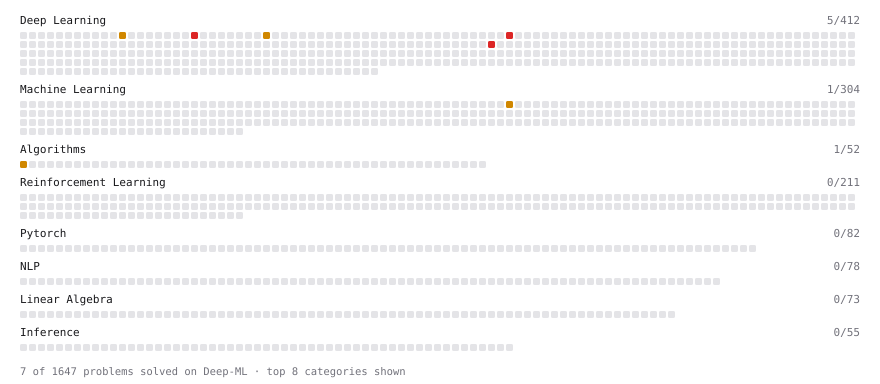

# Deep-ML

My machine learning practice from [Deep-ML](https://www.deep-ml.com). Every solution here was written by hand.

**9** solved · 9 problems · 0 labs · 0 math

[**Browse the interactive portfolio**](https://NaCl2567.github.io/deep-ml/) to replay this filling in over time.

## Problems

| | Difficulty | Solved | |
| --- | --- | --- | --- |
| [Unified Task Handler for Multi-Task RL Agent](https://www.deep-ml.com/problems/554) | easy | 2026-10-20 | [solution](problems/0554-unified-task-handler-for-multi-task-rl-agent) |
| [Alpha-Beta Pruning Implementation](https://www.deep-ml.com/problems/632) | medium | 2026-10-19 | [solution](problems/0632-alpha-beta-pruning-implementation) |
| [Continuous Batching (In-Flight Batching) Simulator](https://www.deep-ml.com/problems/425) | medium | 2026-10-21 | [solution](problems/0425-continuous-batching-in-flight-batching-simulator) |
| [Implement Masked Self-Attention](https://www.deep-ml.com/problems/107) | medium | 2026-10-19 | [solution](problems/0107-implement-masked-self-attention) |
| [Implement Self-Attention Mechanism](https://www.deep-ml.com/problems/53) | medium | 2026-10-19 | [solution](problems/0053-implement-self-attention-mechanism) |
| [Implement the Huber Loss Function](https://www.deep-ml.com/problems/192) | medium | 2026-10-19 | [solution](problems/0192-implement-the-huber-loss-function) |
| [Flash Attention v1 - Forward Pass](https://www.deep-ml.com/problems/208) | hard | 2026-10-19 | [solution](problems/0208-flash-attention-v1-forward-pass) |
| [Implement Multi-Head Attention](https://www.deep-ml.com/problems/94) | hard | 2026-10-19 | [solution](problems/0094-implement-multi-head-attention) |
| [Implementing PagedAttention: Block-wise Attention Computation](https://www.deep-ml.com/problems/492) | hard | 2026-10-19 | [solution](problems/0492-implementing-pagedattention-block-wise-attention-computation) |

---

_This file is regenerated by Deep-ML on every push._
